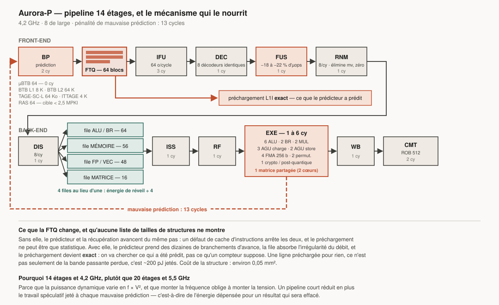

# 2. Microarchitecture CPU

Trois classes de cœurs, une seule ISA, un seul modèle de cohérence. Un binaire
s'exécute à l'identique sur les trois — seule la vitesse change.

| | **Aurora-P** (Prime) | **Aurora-E** (Efficient) | **Aurora-L** (Lumen) |
|---|---|---|---|
| Exécution | out-of-order, 8 de large | out-of-order, 4 de large | in-order, 2 de large |
| Fréquence cible (N2P) | 4,2 GHz | 2,8 GHz | 1,0 GHz |
| ROB | 512 | 192 | — |
| L1I / L1D | 64 + 64 Ko | 32 + 32 Ko | 16 + 16 Ko |
| L2 privé | 2 Mo | 1 Mo partagé par 4 | 128 Ko |
| Vectoriel | 2 × 256 b | 1 × 256 b | 1 × 128 b |
| Matriciel | 1 unité / 2 cœurs | 1 unité / 4 cœurs | non |
| Surface estimée (N2P, hors L2) | ~1,9 mm² | ~0,48 mm² | ~0,09 mm² |
| Puissance à la fréquence max | 4,54 W | 0,64 W | ~0,05 W |
| IPC (SPECint2017/GHz) | 2,87 | 1,78 | 0,80 |

Les surfaces et puissances sont des **estimations** par extrapolation de dies
publiés et mise à l'échelle par les facteurs de densité N2 (§11.1). Incertitude
de l'ordre de ±25 %.

---

## 2.1 Aurora-P : vue d'ensemble du pipeline



*Le schéma montre ce qu'une liste de tailles de structures ne peut pas montrer :
le prédicteur court devant la récupération, et c'est la file de cibles qui le
lui permet.*

```
 ┌──────────────── FRONT-END (découplé) ────────────────┐
 │  BP  →  FTQ  →  IFU  →  DEC  →  FUS  →  RNM          │
 │  2 cy   file    3 cy    1 cy   1 cy   1 cy           │
 └──────────────────────────────────────────────────────┘
                          ↓
 ┌──────────────── BACK-END (out-of-order) ─────────────┐
 │  DIS → files distribuées → ISS → RF → EXE → WB → CMT │
 │  1 cy                       1 cy  1 cy   1-6   1   2 │
 └──────────────────────────────────────────────────────┘

 Pénalité de mauvaise prédiction : 13 cycles (cible)
 Profondeur totale : 14 étages
```

**Pourquoi 14 étages et 4,2 GHz, et pas 20 étages et 5,5 GHz ?** Parce que la
puissance dynamique varie en f × V², et que monter la fréquence exige de monter
la tension. Un pipeline plus court réduit aussi la pénalité de mauvaise
prédiction, donc le travail spéculatif jeté — c'est-à-dire de l'énergie
dépensée pour rien. Le point de fonctionnement 4,2 GHz / 14 étages est le
compromis retenu ; il correspond à ce que les implémentations RISC-V haut de
gamme atteignent déjà (3,85 GHz sur Veyron V2) plus le gain de procédé N2P.

---

## 2.2 Front-end : là où se gagne ou se perd la partie

C'est le bloc le plus sous-estimé. Un front-end médiocre annule n'importe quel
back-end. Un front-end qui spécule mal brûle de l'énergie en pure perte.

### Prédiction de branchement

| Structure | Taille | Latence | Rôle |
|---|---|---|---|
| µBTB | 64 entrées | 0 cycle | prédiction à latence nulle, boucles serrées |
| BTB L1 | 8 192 entrées | 1 cycle | cas courant |
| BTB L2 | 65 536 entrées | 3 cycles | code volumineux (bases de données, navigateurs) |
| TAGE-SC-L | 64 Ko de tables, 12 composantes | 2 cycles | direction |
| ITTAGE | 4 096 entrées | 2 cycles | branchements indirects (interpréteurs, vtables) |
| RAS | 64 entrées + réparation | 1 cycle | retours de fonction |
| Prédicteur de boucle | 128 entrées | — | compte les itérations exactement |

Le prédicteur dispose de trois niveaux à latences croissantes : le µBTB répond
immédiatement, et les niveaux supérieurs **corrigent** la prédiction quelques
cycles plus tard (*overriding predictor*). On paye la précision seulement quand
elle change quelque chose.

Objectif : **< 2,5 mauvaises prédictions pour 1000 instructions** sur SPECint.
C'est le seuil à partir duquel un ROB de 512 entrées devient exploitable ;
au-delà, on remplit une fenêtre qu'on va jeter.

### Fetch découplé (FTQ)

Le prédicteur court **devant** le fetch, et pousse des blocs à récupérer dans
une file (*Fetch Target Queue*) de 64 entrées. Trois conséquences :

1. Le prédicteur peut prendre de l'avance sur des dizaines de branchements et
   déclencher des préchargements d'instructions **exacts** — pas
   statistiques : on précharge ce que le prédicteur a réellement prédit.
2. Un défaut de cache d'instructions n'arrête plus le prédicteur.
3. La file absorbe les irrégularités du débit de décodage.

C'est la structure qui distingue un front-end de classe mondiale d'un front-end
correct, et elle coûte peu : ~0,05 mm².

### Récupération et décodage

- Récupération de **64 octets par cycle** depuis un L1I de 64 Ko, 8 voies,
  avec prédécodage des frontières (trivial : 2 ou 4 octets, jamais autre chose).
- **8 décodeurs symétriques**. Aucun n'est « simple » ou « complexe » : avec une
  longueur fixe, tous les décodeurs sont identiques, ce qui élimine les
  contraintes d'alignement qui plombent les front-ends x86.
- **Aucun cache d'µops.** Justification chiffrée : un cache d'µops de 4 000
  entrées occupe ~0,6 mm² et consomme en fuite en permanence. Le décodage
  Aurora coûte environ 0,9 pJ par instruction. Pour rembourser la fuite du
  cache d'µops, il faudrait un taux de succès irréaliste. À la place :
- **Un tampon de boucle de 192 µops** qui court-circuite fetch et décodage sur
  les boucles serrées — 90 % du bénéfice pour 8 % de la surface.

### Fusion (étage FUS)

Un étage dédié applique la liste contractuelle de §1.7. Le matériel travaille
sur une fenêtre de 8 instructions décodées et fusionne jusqu'à 4 paires par
cycle. Objectif : **18–22 %** de réduction du nombre d'µops.

---

## 2.3 Renommage et fenêtre d'instructions

| Ressource | Taille | Remarque |
|---|---|---|
| Largeur de renommage | 8 µops/cycle | |
| ROB | 512 entrées | groupées par 4 pour économiser les ports |
| PRF entier | 384 registres | |
| PRF flottant / vectoriel | 320 registres × 256 b | |
| PRF matriciel | 16 tuiles physiques (8 architecturales) | |
| File de chargements | 192 | |
| File de stores | 128 | |
| Points de reprise (checkpoints) | 32 | reprise en 1 cycle |

**Élimination au renommage** — travail supprimé avant même d'atteindre les
files d'exécution :
- copies de registre (`mv`) : zéro cycle d'exécution ;
- idiomes de mise à zéro (`xor rd,rd,rd`, `li rd,0`) ;
- additions de constantes fusionnées ;
- `addi rd, rs, 0` dégénéré.

Sur du code compilé réel, cela retire 5 à 9 % des µops. Chaque µop supprimée
est un réveil d'ordonnanceur, une lecture de registre et une écriture en moins.

---

## 2.4 Ordonnancement : quatre files, et non une

L'énergie d'un ordonnanceur croît approximativement en **O(N²)** avec le nombre
d'entrées, parce que chaque résultat produit doit réveiller chaque entrée en
attente. Une file unifiée de 200 entrées est donc catastrophique
énergétiquement.

Aurora distribue :

| File | Entrées | Alimente |
|---|---|---|
| ALU / branchement | 64 | 6 ALU, 2 unités de branchement |
| Mémoire | 56 | 3 AGU chargement, 2 AGU store |
| FP / vectoriel | 48 | 4 FMA, 1 div/sqrt, unité de permutation |
| Matriciel | 16 | unité matricielle partagée |

Total 184 entrées, mais l'énergie de réveil correspond à 4 files moyennes de
46 entrées : **environ 4× moins** qu'une file unifiée équivalente.

Coût : un ordonnancement légèrement moins optimal (une µop ALU ne peut pas
utiliser un créneau libre de la file FP). Mesure sur les architectures
comparables : 1 à 2 % d'IPC. C'est un échange très favorable.

**Réveil spéculatif** : les consommateurs d'un chargement sont réveillés en
supposant un succès L1. En cas d'échec, une reprise sélective rejoue uniquement
la chaîne dépendante — pas le pipeline entier. Sans cela, la latence de 5
cycles du L1D coûterait 5 cycles de bulle à chaque chargement.

---

## 2.5 Unités d'exécution

| Unité | Nombre | Latence | Détail |
|---|---|---|---|
| ALU simple | 6 | 1 cycle | dont 2 avec décalage fusionné |
| Multiplieur entier | 2 | 3 cycles | pipeliné |
| Diviseur entier | 1 | 6–18 cycles | Radix-16 |
| Branchement | 2 | 1 cycle | |
| AGU chargement | 3 | — | 3 chargements par cycle |
| AGU store | 2 | — | |
| FMA 256 b | 4 | 4 cycles | FP64/32/16/BF16 |
| Div/sqrt FP | 1 | 8–14 cycles | Newton-Raphson |
| Permutation vectorielle | 2 | 2–4 cycles | shuffle, gather registre |
| Crypto | 1 | 2–4 cycles | AES, SHA, NTT post-quantique |
| **Matricielle** | 1 / 2 cœurs | 8 cy de latence, 1 `mmacc` / 32 cy en FP16 | réseau 32×32, voir ci-dessous |

### L'unité matricielle

Structure : réseau systolique **32 × 32** de MAC. Une instruction `mmacc`
(produit de deux tuiles 32 × 32) représente 32 768 MAC, soit 32 cycles
d'occupation du réseau en FP16 — la latence de 8 cycles est celle du pipeline,
pas celle de l'instruction complète.

| Format | Débit | Par cycle |
|---|---|---|
| FP16 / BF16 | 1 024 MAC/cycle | 2 048 FLOP |
| MXFP8 | 2 048 MAC/cycle | 4 096 FLOP |
| MXFP4 | 4 096 MAC/cycle | 8 192 FLOP |
| INT8 | 2 048 MAC/cycle | — |

À 4,2 GHz, une unité en MXFP4 produit ~34,4 TFLOP/s. Sur un Aurora-S à
64 cœurs P (32 unités), cela donne ~1,1 PFLOP/s côté CPU — qui s'ajoute au GPU.

**Pourquoi la partager entre deux cœurs ?** Parce que les charges matricielles
sont rarement réparties uniformément sur tous les threads. Une unité par cœur
serait inactive la plupart du temps tout en fuyant en permanence. Le partage
divise la surface par deux avec une perte de débit inférieure à 10 % sur les
charges réelles (un seul thread par paire sature l'unité).

---

## 2.6 Sous-système mémoire du cœur

| Structure | Caractéristiques |
|---|---|
| L1I | 64 Ko, 8 voies, 64 o/ligne, VIPT, latence 3 cycles |
| L1D | 64 Ko, 8 voies, 64 o/ligne, VIPT, latence 5 cycles, 3 lectures + 2 écritures/cycle |
| L1 DTLB | 128 entrées, entièrement associatif, multi-tailles de page |
| L2 TLB | 3 072 entrées, 12 voies |
| L2 | 2 Mo, 16 voies, latence 14 cycles, inclusif du L1I, non-inclusif du L1D |
| Mémoire de tuile | 256 Ko par paire de cœurs, adressable, cible de `Xaurdma` |
| MSHR | 32 sur L1D, 48 sur L2 |

### Désambiguïsation mémoire

Prédicteur de type *store-set* à 4 096 entrées : il apprend quels chargements
entrent réellement en conflit avec quels stores, et n'attend que dans ces cas.
Sans cela, soit on ordonne tout (perte massive d'IPC), soit on spécule
systématiquement (rejeux coûteux).

### Préchargement

Quatre préchargeurs, **sous budget** :

1. **Stride** L1, 64 flux.
2. **Corrélation spatiale** L2 (motifs de page récurrents).
3. **Piloté par descripteurs** (`Xaurdma`) — exact, pas statistique.
4. **Piloté par thread découplé** (`Xaurdt`) — pour l'irrégulier.

Chaque préchargeur a un **compteur de précision**. Sous 60 % d'exactitude, il
est automatiquement bridé, et sous 35 %, désactivé pour la phase en cours. Un
préchargement inutile, ce n'est pas seulement de la bande passante perdue :
c'est ~200 pJ jetés (§0.3). Le contrôle de précision est ici une décision
**énergétique** avant d'être une décision de performance.

---

## 2.7 Aurora-E : l'efficacité, pas la lenteur

Un cœur E n'est pas un cœur P bridé. C'est une microarchitecture différente,
optimisée pour un point de fonctionnement différent : **maximiser le travail
par joule**, pas le travail par seconde.

| Caractéristique | Valeur | Justification |
|---|---|---|
| Largeur | 4 | au-delà, le rendement décroît vite sur code entier |
| ROB | 192 | suffisant pour absorber un échec L2 partiel |
| Files | 2 (ALU+BR, MEM+FP) | énergie de réveil minimale |
| ALU | 3 | |
| FMA | 1 × 256 b | |
| L1 | 32 + 32 Ko | |
| L2 | 1 Mo partagé par grappe de 4 | amortit la surface |
| Prédicteur | TAGE 16 Ko, BTB 2 048 | 80 % de la précision du P pour 25 % de la surface |
| Fréquence | 2,8 GHz max, **1,2 GHz au point d'efficacité** | |
| Tension min | 0,55 V | GAA le permet |

**Les chiffres qui comptent** (sortie du modèle, [§11.3](11-modele-performance.md)) :

| Comparaison | Résultat |
|---|---|
| Cœur E à 1,2 GHz / 0,55 V, vs cœur P en boost | 18 % de la performance pour **3 % de la puissance** (0,14 W contre 4,54 W), soit **5,6× la perf/W** |
| Cœur E à 2,8 GHz, vs cœur P en boost | 41 % de la performance, 14 % de la puissance, **2,9× la perf/W** |
| **4 cœurs E (surface d'un cœur P)** vs 1 cœur P en boost | **165 % du débit pour 56 % de la puissance**, soit **2,94× la perf/W** |

La dernière ligne est le fondement quantitatif de l'architecture hybride : à
surface de silicium identique, on obtient plus de débit pour presque moitié
moins de puissance. C'est la conséquence directe du terme en V².

C'est là que se gagne la perf/W en multi-thread, et c'est pourquoi Aurora
donne aux cœurs E le **vectoriel complet et la matrice** : un cœur E amputé
force l'ordonnanceur à migrer les threads vers les cœurs P, ce qui annule
l'avantage. L'erreur d'AVX-512 sur les architectures hybrides x86 est
instructive — une ISA asymétrique casse l'ordonnancement.

---

## 2.8 Aurora-L : le domaine toujours allumé

Deux cœurs in-order 2 de large à 1,0 GHz, 16 Ko de L1, 128 Ko de L2, dans un
**domaine d'alimentation séparé** qui reste actif quand tout le reste dort.

Rôle : traitement des capteurs, réveil sur mot-clé, maintien des connexions
réseau, horloges, notifications, contrôle thermique. Consommation cible :
**< 50 mW actif, < 3 mW en veille avec rétention**.

Sans ce domaine, réveiller un cœur E pour lire un accéléromètre coûte plusieurs
centaines de microjoules en transition d'état. Sur une journée, c'est la
différence entre « tient la journée » et « tient deux jours ».

---

## 2.9 Pourquoi pas de SMT sur les cœurs P

Trois raisons, dans l'ordre d'importance :

1. **Sécurité.** Le partage de structures microarchitecturales entre deux
   contextes est un canal auxiliaire par construction. L'historique est sans
   appel. Aucune atténuation connue n'est à la fois complète et gratuite.
2. **Perf/W.** Le SMT augmente le débit de 15–25 % pour ~7 % de surface, mais
   il augmente la *pression* sur tous les caches et tous les prédicteurs, ce
   qui dégrade la perf/W sur les charges client. Sur un système hétérogène,
   deux cœurs E font mieux, pour moins cher en énergie.
3. **Latence.** Le SMT dégrade la performance mono-thread du thread
   prioritaire, ce qui est exactement l'inverse du rôle d'un cœur P.

**Exception assumée :** la déclinaison serveur Aurora-S propose un SMT 2 voies
*activable par partition*, avec partitionnement statique des files et des
prédicteurs (pas de partage dynamique). Les charges de type base de données et
microservices en bénéficient réellement, et l'opérateur d'un centre de données
peut faire ce choix en connaissance de cause. La valeur par défaut est
**désactivé**.

---

## 2.10 Grappes et organisation

**Grappe P** — 4 cœurs P, 8 Mo de L2 (2 Mo chacun), 2 unités matricielles,
512 Ko de mémoire de tuile, une interface vers le die de base.

**Grappe E** — 8 cœurs E, 2 Mo de L2 partagés (2 sous-grappes de 4), 2 unités
matricielles, 256 Ko de mémoire de tuile.

Surface estimée par grappe (N2P) : ~14 mm² pour une grappe P, ~7,5 mm² pour une
grappe E.

Les grappes communiquent uniquement par le die de base : **pas d'interconnexion
latérale entre grappes**. Cela simplifie le protocole de cohérence, réduit la
longueur des fils, et permet de composer les produits en empilant des grappes
identiques.

---

## 2.11 Migration rapide entre classes de cœurs

Pour qu'un ordonnanceur hétérogène soit efficace, la migration doit être bon
marché — sinon l'OS n'ose pas migrer, et le matériel hétérogène ne sert à rien.

Mécanisme : l'état architectural (registres entiers, flottants, vectoriels,
CSR ; l'état matriciel est exclu s'il est marqué mort par `mtrelease`) est
transféré **via le cache système**, sans passage par la mémoire principale.

| Migration | Coût cible |
|---|---|
| P → E ou E → P (même chiplet) | < 2 µs |
| Entre chiplets | < 6 µs |
| Avec état matriciel sale | + 4 µs |

À comparer aux 50–100 µs typiques d'une migration passant par la mémoire. Sous
10 µs, l'ordonnanceur peut migrer à chaque quantum sans remords, ce qui rend
l'hétérogénéité réellement exploitable.

---

## 2.12 Budget de surface (estimation, N2P)


| Bloc | Surface | Part |
|---|---|---|
| Cœur P (logique seule) | 1,9 mm² | |
| — front-end (BP, fetch, décode, fusion) | 0,44 mm² | 23 % |
| — renommage + ROB + PRF | 0,41 mm² | 22 % |
| — ordonnanceurs + ALU | 0,33 mm² | 17 % |
| — LSU + L1D | 0,42 mm² | 22 % |
| — FP/vectoriel | 0,30 mm² | 16 % |
| L2 2 Mo | 1,4 mm² | |
| Unité matricielle (par paire) | 0,85 mm² | |
| Cœur E (logique) | 0,48 mm² | |
| Cœur L (logique) | 0,09 mm² | |

Ces valeurs sont obtenues par mise à l'échelle de dies publiés vers N2P, avec
les facteurs de densité annoncés par TSMC (§0.2). La SRAM est mise à l'échelle
séparément, car elle rétrécit beaucoup moins vite que la logique — un point que
les extrapolations naïves oublient systématiquement.

---

**Suite :** [3. Microarchitecture GPU](03-gpu-microarchitecture.md)
