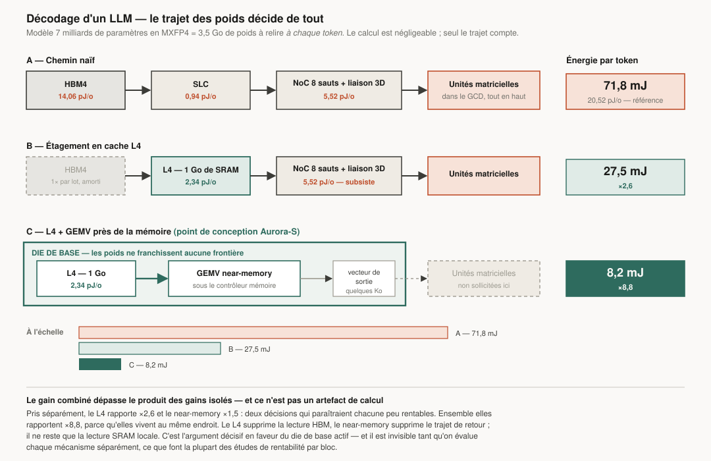

# 4. Hiérarchie mémoire

> C'est le document le plus important du dossier. Si l'ISA et les cœurs étaient
> médiocres mais la hiérarchie mémoire excellente, Aurora serait encore
> compétitive. L'inverse est faux.

---

## 4.1 Le raisonnement en amont de tout

Les coûts énergétiques par accès, à l'échelle du procédé visé (§0.3) :

| Niveau | Énergie par accès 64 o | Latence | Rapport vs L1 |
|---|---|---|---|
| Registre | ~0,1 pJ | 0 cy | 0,05× |
| L1 (64 Ko) | ~2 pJ | 3–5 cy | 1× |
| Mémoire de tuile (256 Ko) | ~6 pJ | 8 cy | 3× |
| L2 (2 Mo) | ~20 pJ | 14 cy | 10× |
| SLC 3D (64 Mo) | ~60 pJ | 35–45 cy | 30× |
| LPDDR6 | ~1 300 pJ | ~90 ns | 650× |
| HBM4 | ~900 pJ | ~110 ns | 450× |

**Un accès DRAM coûte l'équivalent de 650 accès L1.** Toute la conception est
l'application obstinée d'une seule règle : *faire en sorte que l'accès suivant
soit servi un niveau plus haut.*

Corollaire moins évident : la hiérarchie ne doit pas seulement être grande,
elle doit être **exacte**. Un cache de 256 Mo rempli de données inutiles coûte
de la fuite et ne sert à rien. D'où l'attention portée plus bas aux politiques
de remplacement, à la qualité du préchargement et au contournement.

---

## 4.2 Vue d'ensemble

```
          ┌──────────── Chiplet logique (N2P / A16) ─────────────┐
 Cœur P ──┤ L1I/L1D 64+64K ── L2 privé 2 Mo ──┐                  │
 Cœur P ──┤ L1I/L1D 64+64K ── L2 privé 2 Mo ──┤                  │
          │        mémoire de tuile 256 Ko / paire               │
          └──────────────────────┬───────────────────────────────┘
                   hybrid bonding │  ~0,05 pJ/bit, 2,5+ To/s
          ┌───────────────────────┴──────────────────────────────┐
          │         DIE DE BASE (nœud mature, N5/N6)             │
          │  SLC 32–256 Mo tranché · répertoire de cohérence     │
          │  NoC maillé · moteurs de flux · unités near-memory   │
          │  contrôleurs LPDDR6 / HBM4 · PHY                     │
          └───────────────────────┬──────────────────────────────┘
                     empilement   │
          ┌───────────────────────┴──────────────────────────────┐
          │       L4 optionnel : 256 Mo – 1 Go de SRAM 3D        │
          └──────────────────────────────────────────────────────┘
                                  │
                       LPDDR6  ou  HBM4 (piles)
```

---

## 4.3 Niveaux 1 et 2

Détaillés au document 2. Trois points méritent d'être repris ici :

**L1D en VIPT** (*virtually indexed, physically tagged*) : l'indexation
commence avant la traduction d'adresse, ce qui retire la TLB du chemin
critique. Contrainte : taille ≤ associativité × taille de page. Avec 64 Ko en
8 voies et des pages de 4 Ko, on tombe juste — sans recourir aux astuces
coûteuses de gestion d'alias.

**L2 non-inclusif du L1D, inclusif du L1I.** L'inclusion du L1D gaspillerait
128 Ko sur 2 Mo et forcerait des invalidations en cascade. L'inclusion du L1I,
en revanche, simplifie beaucoup l'invalidation du code (JIT, chargement de
bibliothèques) pour un coût négligeable.

**Remplacement RRIP** plutôt que LRU : le LRU se comporte mal sur les balayages
(*streaming*), motif omniprésent en pratique. RRIP détecte les lignes à faible
réutilisation et les évince en priorité, pour un coût de 2 bits par ligne.

---

## 4.4 Le cache système (SLC) : le cœur du dispositif

**Position : sur le die de base, sous les chiplets logiques, relié par hybrid
bonding.** C'est le choix structurant d'Aurora.

| Config | Capacité SLC | Tranches | Bande passante |
|---|---|---|---|
| Aurora-M | 32 Mo | 8 × 4 Mo | ~4 To/s |
| Aurora-D | 64 Mo | 16 × 4 Mo | ~8 To/s |
| Aurora-S | 256 Mo | 32 × 8 Mo | ~12 To/s |

### Pourquoi empiler plutôt que juxtaposer

Le 3D V-Cache de deuxième génération d'AMD, à 9 µm de pas, atteint 2,5 To/s
entre cache et cœurs, avec **moins d'un tiers de l'énergie par bit** des
micro-bumps et **15× la densité d'interconnexion**. Une liaison verticale par
hybrid bonding coûte environ un ordre de grandeur de moins qu'une liaison
latérale sérialisée.

Traduit en conséquences d'architecture :

1. Le SLC peut être **beaucoup plus gros** qu'un cache monolithique, car il ne
   dispute pas sa surface aux cœurs.
2. Il est fabriqué sur un **nœud mature** : la SRAM ne rétrécit presque plus
   depuis N5, payer N2 pour du cache est un gaspillage pur.
3. Le die logique, plus petit, a un **meilleur rendement de fabrication** — ce
   qui change l'économie du produit autant que ses performances.

### Fonctions du SLC

- **Cache de dernier niveau partagé** CPU, GPU, moteurs média, DMA. Un seul
  cache pour tout le monde, donc pas de duplication de lignes entre un cache
  CPU et un cache GPU — gain de capacité effective de 15 à 25 % sur les charges
  mixtes.
- **Point de cohérence** : le répertoire y réside (§4.6).
- **Partitionnement** par voies, avec des quotas programmables par classe de
  trafic. Un flux de décodage vidéo n'a pas à évincer le jeu de travail d'une
  base de données.
- **Filtre de contournement** : les lignes détectées comme à usage unique
  (balayage, écriture de framebuffer, flux `Xaurdma`) contournent le SLC pour
  ne pas l'empoisonner.
- **Tampon d'écriture combinée** pour agréger les écritures partielles avant la
  DRAM.

### Politique de remplacement

RRIP amélioré (*Hawkeye*-like) : un prédicteur apprend, par adresse
d'instruction, quelles lignes sont réutilisées, et insère les autres avec une
priorité d'éviction immédiate. Sur les charges à grand jeu de travail, le gain
est de 5 à 12 % de taux de succès face à un LRU, ce qui se traduit directement
en accès DRAM évités — donc en watts.

---

## 4.5 L4 : SRAM empilée pour les configurations serveur et IA

Sur Aurora-S, un étage supplémentaire de 256 Mo à 1 Go de SRAM est empilé sur le
die de base.

| | Valeur |
|---|---|
| Capacité | 256 Mo (base) à 1 Go (variante IA) |
| Latence | ~70–90 cycles |
| Bande passante | ~4 To/s |
| Énergie | ~150 pJ / ligne de 64 o |
| Rôle | victime du SLC + tampon de poids de modèle |

L'usage décisif : **loger les poids d'un modèle**. Un modèle de 7 milliards de
paramètres en MXFP4 occupe ~3,5 Go — trop pour le L4. Mais **une couche**
(~100 Mo) y tient largement. En diffusant les poids couche par couche depuis la
HBM vers le L4, on sert tous les tokens d'un lot depuis le L4 au lieu de la
HBM : ~150 pJ au lieu de ~900 pJ par ligne.

Le modèle ([§11.7](11-modele-performance.md)) chiffre le gain réel à **×2,6**
sur l'énergie par token — et non au facteur 6 que suggère le seul rapport des
énergies d'accès, parce que le trajet comporte aussi le NoC et les liaisons
verticales, qui ne disparaissent pas. Combiné au calcul près de la mémoire
(§4.7), le gain monte à **×8,8** : c'est là que la décision devient
structurante.

C'est un cas où une décision de hiérarchie mémoire change davantage le résultat
qu'un doublement des unités de calcul.

---

## 4.6 Cohérence

Protocole **MOESI** avec **répertoire** (pas de diffusion de snoops), le
répertoire étant distribué sur les tranches du SLC.

| Décision | Choix | Pourquoi |
|---|---|---|
| Base | répertoire distribué | le snooping ne passe pas l'échelle au-delà de ~16 cœurs |
| Granularité | ligne de 64 o | |
| Suivi | vecteur de bits par grappe, pas par cœur | 16 grappes = 16 bits, contre 100 bits par cœur sur Aurora-S |
| GPU | régions cohérentes déclarées | évite de suivre des gigaoctets de textures qui ne sont jamais partagées |
| Accélérateurs | cohérents via le même répertoire | un seul modèle mental pour le logiciel |

### Le compromis GPU, explicité

Suivre la cohérence de toute la mémoire GPU ligne par ligne coûterait un
répertoire énorme et un trafic de maintenance permanent. Suivre à la
granularité de la page (4 Ko) est bon marché mais provoque du faux partage.

Solution retenue — **cohérence à deux vitesses** :

- **Par défaut**, cohérence à granularité de tampon : le GPU obtient le tampon
  en acquire, le rend en release. Correspond exactement à la sémantique de
  Vulkan et de CUDA/HIP, donc coût nul en pratique.
- **Régions déclarées fines** : une allocation peut être marquée « cohérente
  fine » et devient suivie ligne par ligne. Usage : structures partagées
  CPU/GPU, files de travail, pointeurs, verrous.

Le logiciel obtient la simplicité de la mémoire partagée sans en payer le
coût sur les 99 % de données qui ne sont pas partagées.

### Ordonnancement mémoire

Modèle RVWMO par défaut (faible, efficace). Bit **TSO commutable par hart**
(§1.6) pour la traduction binaire. Les deux coexistent dans le même système : le
LSU maintient l'ordre uniquement pour les harts en mode TSO. C'est possible
parce qu'un programme traduit en mode TSO ne partage pas de mémoire non
synchronisée avec du code natif faible — et quand il le fait, il passe par des
primitives de synchronisation qui imposent l'ordre de toute façon.

---

## 4.7 Calcul près de la mémoire

Sous chaque contrôleur mémoire du die de base, une **unité de proximité** :

| Opération | Justification |
|---|---|
| Réductions (somme, max, min, argmax) | la donnée n'a pas besoin de remonter |
| `memset` / `memcpy` | déplacement intra-mémoire sans traverser le cache |
| Gather/scatter par liste d'index | tables d'embedding, graphes |
| GEMV (matrice × vecteur) | limité par la bande passante par nature |
| Quantification / déquantification | conversion de format à la volée |
| Comparaison et filtrage | prédicats de bases de données |

### Le cas qui justifie le bloc



**Le décodage autorégressif d'un LLM.** À chaque token, il faut lire tous les
poids du modèle et effectuer essentiellement une GEMV. Le rapport calcul/octet
est proche de 1 : c'est un problème de **bande passante pure**, où les unités
de calcul restent inactives.

En exécutant la GEMV près du contrôleur mémoire :

- les poids ne traversent ni le NoC, ni le SLC, ni le banc de registres GPU ;
- seul le vecteur de sortie remonte, soit quelques kilo-octets contre plusieurs
  centaines de mégaoctets lus ;
- le modèle ([§11.7](11-modele-performance.md)) chiffre le gain du seul
  mécanisme *near-memory* à **×1,5** sur l'énergie par token. Pris isolément,
  c'est modeste : la lecture DRAM elle-même reste inévitable et domine.
- **Le gain devient décisif une fois combiné au L4** : parce que le L4 et les
  unités de proximité sont tous deux sur le die de base, les poids ne quittent
  jamais ce die. Le modèle donne alors **×8,8** — très au-dessus du produit des
  gains isolés.

Cette non-additivité est l'argument le plus fort en faveur du die de base
actif (§5.1), et elle n'apparaît qu'en modélisant les deux mécanismes
ensemble. Prise séparément, chacune des deux décisions paraîtrait peu
rentable.

Même raisonnement pour `argmax` sur les logits, pour les tables d'embedding de
systèmes de recommandation, et pour les prédicats de filtrage en base de
données analytique.

**Ce que ce n'est pas :** ce n'est pas du *processing-in-memory* dans les puces
DRAM elles-mêmes (technologie encore immature et dépendante des fondeurs de
mémoire). C'est du calcul dans **notre** die de base, juste derrière le
contrôleur — réalisable avec les technologies de 2026, sans dépendre de
personne.

---

## 4.8 Mémoire principale

### Configuration mobile et desktop — LPDDR6

| | Aurora-M | Aurora-D |
|---|---|---|
| Canaux | 4 × 32 bits | 8 × 32 bits |
| Débit | 14,4 GT/s | 14,4 GT/s |
| Bande passante | ~230 Go/s | ~460 Go/s |
| Capacité | 16–64 Go | 32–256 Go |
| Montage | sur package (mobile) ou LPCAMM3 | LPCAMM3 |

LPDDR6 est le standard JESD209-6 publié en juillet 2025, avec des débits de
10 667 à 14 400 MT/s. Le choix de LPDDR plutôt que DDR en desktop est délibéré :
l'énergie par bit est nettement meilleure, et la bande passante par broche
aussi. Le coût est la modularité — d'où le support de LPCAMM3, qui rétablit la
possibilité de remplacer la mémoire.

### Configuration serveur — HBM4

| | Aurora-S |
|---|---|
| Piles | 4 à 8 |
| Interface | 2 048 bits par pile, 8 Gb/s par broche |
| Bande passante | 2 To/s par pile, soit 8 à 16 To/s |
| Capacité | jusqu'à 64 Go par pile, soit 256–512 Go |

Conforme à JESD270-4. Le VDDQ configurable (0,7 à 0,9 V) est exploité : Aurora
cible 0,7 V quand le fournisseur le permet, ce qui représente environ 20 %
d'économie sur le PHY mémoire.

### Extension — CXL 3.1

Deux ports CXL 3.1 sur le die d'E/S, pour l'extension mémoire et le partage en
pool. Sur Aurora-S, cela permet d'adresser de la mémoire distante cohérente,
avec une latence de l'ordre de 250–400 ns — utilisable pour les jeux de données
froids, pas pour le chemin critique. La hiérarchie le sait : les pages CXL sont
marquées comme un niveau distinct et le système de migration de pages les
traite en conséquence.

---

## 4.9 Compression mémoire

Deux mécanismes, distincts :

**1. Compression de lignes (matérielle, transparente).** Chaque ligne de 64 o
est compressée à la volée par un LZ léger à la sortie du SLC. Les métadonnées
vivent dans le SLC. Ratio observé sur des données réelles : 1,3 à 1,8×. Effet :
autant de bande passante effective en plus, et autant d'énergie de transfert en
moins.

**2. Compression de pages froides (logicielle, assistée).** Les pages non
touchées depuis un seuil sont compressées par un moteur matériel (LZ4/zstd) et
stockées compressées en DRAM. Le noyau gère la politique ; le matériel fait le
travail. Gain de capacité effective : 1,5 à 3× sur les pages froides, pour un
coût de décompression de ~2 µs. C'est l'équivalent matériel de `zswap`, sans en
payer le coût CPU.

---

## 4.10 Traduction d'adresses

| Structure | Taille |
|---|---|
| L1 ITLB / DTLB | 64 / 128 entrées, entièrement associatives |
| L2 TLB unifié | 3 072 entrées, 12 voies |
| Cache de parcours de page | 4 niveaux, 64 entrées par niveau |
| Parcoureurs matériels | 4, parallèles |
| Tailles de page | 4 Ko, 64 Ko (Svnapot), 2 Mo, 1 Go |
| IOMMU | partagée, avec ATS et PRI pour les périphériques |

**Pages de 64 Ko par regroupement (Svnapot)** : elles réduisent la pression TLB
d'un facteur 16 sans imposer au noyau la gestion complexe des grandes pages.
Sur les charges à grand jeu de travail, la traduction d'adresses peut consommer
10 à 20 % du temps ; c'est un poste que l'on oublie régulièrement de compter.

**Partage CPU/GPU** : même format de table de pages, même IOMMU, ASID partagés.
Le GPU peut prendre une faute de page et la faire résoudre par le noyau — sans
cela, la mémoire unifiée n'est qu'un vocabulaire marketing.

---

## 4.11 Récapitulatif : où va l'énergie mémoire

Sortie du modèle ([§11.5](11-modele-performance.md)) :

| Configuration | Hors cœur | Intra-cœur (registres, L1, L2, fils) | **Total déplacement** |
|---|---|---|---|
| Aurora-M (11,0 W) | 1,40 W — 12,7 % | 2,32 W — 21,0 % | **33,7 %** |
| Aurora-D (87,4 W) | 5,35 W — 6,1 % | 29,32 W — 33,5 % | **39,7 %** |
| Aurora-S (382,6 W) | 109,8 W — 28,7 % | 94,1 W — 24,6 % | **53,3 %** |

Deux précisions, parce que ce tableau se lit mal sans elles :

1. **Le déplacement intra-cœur est déjà compté** dans la puissance des cœurs et
   du GPU. Il est isolé ici à titre de diagnostic, en retenant la part de 40 %
   que la littérature attribue aux bancs de registres, aux caches privés et aux
   réseaux d'opérandes dans un cœur large ou un GPU.
2. Le poste « hors cœur » paraît petit sur Aurora-D (6 %) précisément **parce
   que** le SLC est empilé, que le GPU est en TBDR et que le trafic est
   compressé. C'est le résultat de l'optimisation, pas la preuve qu'elle était
   inutile.

Sur Aurora-S, **plus de la moitié de l'énergie sert à déplacer des données** —
et c'est déjà après optimisation. Optimiser les unités de calcul d'une
architecture IA, c'est optimiser moins de la moitié du problème.

---

**Suite :** [5. Interconnexion et chiplets](05-interconnect-chiplets.md)
