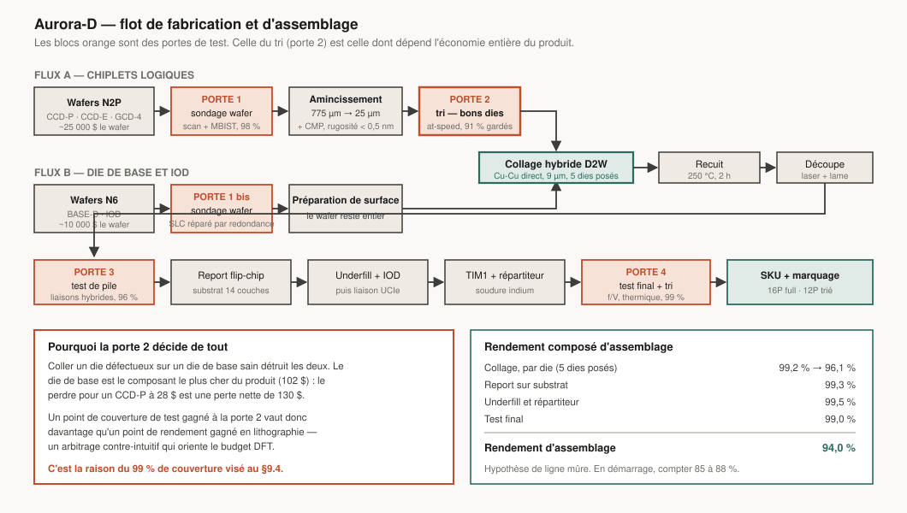

# 9. Vérification et implémentation

> Sur un programme de cette taille, la vérification représente environ **60 %
> de l'effort d'ingénierie matérielle**. Ce n'est pas une phase finale, c'est
> l'activité principale.

---

## 9.1 Le flot, de bout en bout

```
Spécification exécutable (Sail)  ──┐
                                   ├──► oracle de référence
Modèle de performance (§11)      ──┘
            ↓
Simulateur cycle-approché (gem5 étendu)
            ↓  calibration
RTL (Chisel pour le contrôle, SystemVerilog pour les datapaths)
            ↓
Vérification : simulation + formel + émulation + FPGA
            ↓
Synthèse → placement-routage → signoff
            ↓
Tape-out → bring-up → validation → production
```

### Langages

| Bloc | Langage | Raison |
|---|---|---|
| Spécification ISA | **Sail** | c'est déjà la spécification formelle officielle de RISC-V ; on l'étend plutôt que d'en réinventer une |
| Contrôle, générateurs | **Chisel** | la paramétrisation (largeurs, tailles de file, nombre de cœurs) est une exigence de premier rang : un seul générateur produit P, E et L |
| Datapaths critiques | **SystemVerilog** | contrôle fin du timing, intégration des mémoires compilées |
| Vérification | **SystemVerilog UVM** + **cocotb** | industrie pour l'un, agilité pour l'autre |
| Propriétés formelles | **SVA** | |

Le choix de Chisel pour les générateurs est délibéré : produire trois
microarchitectures de cœur depuis une base paramétrée divise l'effort de
vérification, parce que les propriétés prouvées sur le générateur valent pour
toutes les instanciations.

---

## 9.2 Les cinq niveaux de vérification

### 1. Vérification formelle

| Cible | Propriété prouvée |
|---|---|
| Décodeur | équivalence avec la spécification Sail, exhaustive |
| ALU, FPU | conformité IEEE 754, exhaustive par preuve |
| Protocole de cohérence | absence d'interblocage, de famine, sûreté (tout accès voit la dernière écriture) |
| Arbitres NoC | absence d'interblocage, équité |
| Logique de sécurité | non-interférence entre domaines |
| Machines d'état de puissance | tout état atteint est quittable |
| Pile d'ombre, CHERI | intégrité des capacités : aucune séquence ne fabrique une capacité valide |

**La non-interférence est la propriété la plus précieuse.** Prouver
formellement qu'aucune séquence d'instructions du domaine A ne peut modifier
l'état observable du domaine B est infiniment plus fort que de tester des
milliers de cas. C'est l'approche qui manquait avant Spectre.

### 2. Simulation dirigée par la couverture

- **UVM** avec génération de stimuli contraints-aléatoires.
- Modèle de référence : le modèle Sail, comparé instruction par instruction.
- Objectif : **100 % de couverture de code, 100 % de couverture fonctionnelle**
  sur le modèle de couverture défini avec l'architecture — pas après coup.
- ~40 000 cœurs de ferme de calcul en pointe.

### 3. Émulation matérielle

Émulateur commercial (classe Palladium/Veloce) : le SoC complet tourne à
~1,5 MHz. Assez lent pour être frustrant, assez rapide pour **démarrer Linux**,
lancer la suite de conformité Vulkan, et exécuter des charges réelles.

Règle : **Linux doit démarrer sur émulateur à M28**, soit huit mois avant le
tape-out. Un système qui ne démarre qu'après le silicium découvre ses problèmes
quand les corriger coûte 25 M$ et six mois.

### 4. Prototypage FPGA

| Plateforme | Contenu | Fréquence |
|---|---|---|
| FPGA simple | 1 cœur P + cache | ~50 MHz |
| Ferme FPGA (8 cartes) | 4 P + 8 E + 2 Slices GPU + SLC | ~25 MHz |
| Cloud FPGA | flotte pour l'équipe logicielle | ~20 MHz |

À 25 MHz, on est ~150× plus lent qu'un silicium — mais suffisamment rapide pour
que **l'équipe logicielle travaille réellement dessus** : compiler, déboguer un
pilote, exécuter des tests. La ferme FPGA est un investissement logiciel déguisé
en investissement matériel.

### 5. Silicium de test (MPW)

Une navette multi-projets à M24, sur N2 :

- un cœur P complet + L2 ;
- une Slice GPU réduite ;
- une macro de test d'unité matricielle ;
- les PHY critiques (LPDDR6, UCIe) ;
- des structures de caractérisation (anneaux oscillants, SRAM, capteurs).

Coût : ~8 M$. Valeur : **validation du procédé et des PHY avant d'engager le
tape-out complet**. La plupart des surprises de premier silicium concernent les
blocs analogiques ; les sortir un an plus tôt est le meilleur achat du
programme.

---

## 9.3 Vérification spécifique aux points durs

| Point dur | Méthode |
|---|---|
| Cohérence multi-chiplet | formel sur le protocole + litmus tests (modèle RVWMO officiel) |
| Modèle mémoire TSO commutable | **suite litmus exécutée dans les deux modes**, plus preuve que la commutation est sûre |
| Traduction binaire | tests différentiels x86 réel vs traduit (§8.4) |
| État matriciel + changement de contexte | tests aléatoires de commutation sous charge matricielle |
| Gestion d'énergie | vérification des machines d'état de puissance + tests de stress de transition (millions de transitions aléatoires) |
| Sécurité spéculative | **équipe rouge dédiée** qui tente d'exfiltrer des données sur le RTL, pas seulement sur le silicium |
| Intégrité 3D | simulation thermique et d'alimentation couplée entre les dies empilés |

L'équipe rouge sur RTL mérite d'être soulignée : chercher des canaux auxiliaires
sur le RTL permet de les corriger avant le silicium. Après, il ne reste que des
atténuations logicielles coûteuses.

---

## 9.4 Design for Test (DFT)




| Mécanisme | Couverture visée |
|---|---|
| Chaînes de balayage (scan) compressées | > 99 % de défauts collés |
| Test at-speed (transition) | > 95 % |
| **MBIST** avec réparation par redondance | toutes les mémoires |
| LBIST | auto-test logique en fonctionnement (exigence automobile/sécurité) |
| Test de connexion des liaisons hybrid bonding | dédié, avant et après empilement |
| Capteurs de vieillissement | 32 par die, suivi de la dégradation |

Le test **known good die** est vital dans une stratégie d'empilement : coller
un die défectueux sur un die de base sain détruit les deux. On teste donc chaque
die à ~98 % de couverture avant assemblage, et on retente le test complet après.

---

## 9.5 Physical design

| Paramètre | Valeur |
|---|---|
| Nœud | N2P (logique), N6/N5 (die de base) |
| Bibliothèques de cellules | hauteur mixte : 6 pistes pour les chemins critiques, 5 pistes pour la densité |
| Vt | ULVT sur les chemins critiques, SVT par défaut, HVT partout où le timing le permet |
| Alimentation | chiplets empilés : par la liaison hybride depuis le die de base (§12.3) ; BSPD A16 dans le die de base et sur les variantes non empilées |
| Horloge | arbres maillés pour les cœurs, H-tree pour le NoC |
| Signoff timing | 5 coins de procédé × 3 températures × 3 tensions |
| Objectif de densité | > 72 % d'utilisation |

**Le mix de Vt est un levier énergétique sous-estimé.** Un transistor HVT fuit
5 à 10× moins qu'un ULVT mais commute plus lentement. Sur un cœur, seuls 3 à 5 %
des chemins sont réellement critiques. Pousser tout le reste en HVT peut réduire
la fuite totale de 40 % pour une perte de fréquence nulle. C'est un travail
d'optimisation fastidieux, jamais glamour, toujours rentable.

### Méthodologie hiérarchique

Le design est hiérarchique et non aplati : chaque cœur est un bloc physique
durci et réutilisé, les grappes assemblent des cœurs durcis, et le top assemble
les grappes. Temps d'itération divisé par ~5 face à une approche aplatie, au
prix de 3 à 6 % de densité — échange évident sur un design de cette taille.

---

## 9.6 Calendrier de vérification

| Jalon | Échéance | Critère de sortie |
|---|---|---|
| Spécification Sail complète | M8 | tests de conformité RISC-V passent sur le modèle |
| Simulateur calibré | M14 | ±10 % vs RTL sur les premiers blocs |
| RTL cœur P fonctionnel | M18 | démarre un noyau simple en simulation |
| Formel : cohérence prouvée | M22 | absence d'interblocage prouvée |
| Linux sur émulateur | M28 | démarrage complet en espace utilisateur |
| Conformité Vulkan sur émulateur | M30 | suite Khronos passe |
| **Gel du RTL** | M33 | couverture 100 %, zéro bogue bloquant ouvert |
| Signoff physique | M36 | timing, IR, EM, DRC/LVS propres |
| **Tape-out A0** | M36 | |
| Retour silicium | M41 | |
| Bring-up | M41–M44 | démarrage Linux sur silicium |
| Silicium de production B0 | M52 | |

**Le gel du RTL à M33 pour un tape-out à M36** laisse trois mois de signoff.
C'est serré et volontairement affiché comme tel : l'expérience montre que ce
créneau est le premier à déraper, et il faut le protéger explicitement dans le
plan plutôt que de le découvrir.

---

## 9.7 Bring-up

Ordre d'allumage, chaque étape conditionnant la suivante :

1. Alimentations, horloges, PLL — vérifier qu'on a du courant et une horloge.
2. Scan et JTAG — pouvoir parler à la puce.
3. Cœur L et sous-système sécurisé — le plus petit cœur démarre en premier.
4. SRAM et MBIST.
5. Un cœur P en exécution depuis une ROM.
6. Contrôleur mémoire et entraînement du PHY DRAM — **l'étape la plus risquée**.
7. Cohérence multi-cœurs.
8. Liaisons hybrid bonding vers le die de base.
9. Démarrage Linux.
10. GPU, puis affichage.
11. Gestion d'énergie et DVFS.
12. Caractérisation complète (fréquence-tension, température, fuite).

Objectif : **Linux en espace utilisateur dans les 21 jours** suivant la
réception du silicium. C'est agressif, et c'est atteignable uniquement parce
que tout a déjà démarré sur émulateur et FPGA. Le bring-up ne découvre alors que
les problèmes électriques réels, pas les bogues logiques.

---

## 9.8 Ce qui va mal se passer

Une planification qui n'anticipe pas ses échecs n'est pas une planification.
Les défaillances les plus probables, par ordre de vraisemblance :

| Problème | Probabilité | Plan de réponse |
|---|---|---|
| Entraînement du PHY mémoire instable | **élevée** | MPW à M24 pour caractériser tôt ; marges de conception généreuses ; équipe dédiée |
| Fréquence 10–15 % sous la cible | **élevée** | la gamme se décline en SKU ; le modèle de perf ne dépend pas uniquement de la fréquence |
| Rendement d'empilement sous l'objectif | moyenne | ligne pilote dès M18 ; variante de repli sans L4 |
| Bogue de cohérence découvert après silicium | moyenne | vérification formelle en amont ; contournements par firmware prévus |
| Fuite supérieure aux prévisions | moyenne | mix de Vt réajustable en B0 ; power gating plus agressif |
| Pilote graphique en retard | **élevée** | voir §8.6, c'est le risque principal du programme |
| Respin nécessaire (A0 → A1) | ~50 % | **budgété d'office** : 25 M$ et 4 mois dans le plan de base |

Un respin à 50 % de probabilité n'est pas du pessimisme, c'est la statistique
du secteur pour un design neuf de cette complexité. Le budgéter, c'est éviter de
transformer un événement attendu en crise.

---

**Suite :** [10. Feuille de route et budget](10-feuille-de-route-budget.md)
