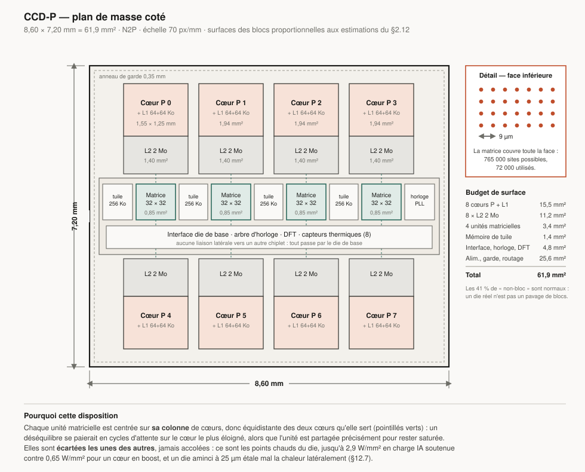
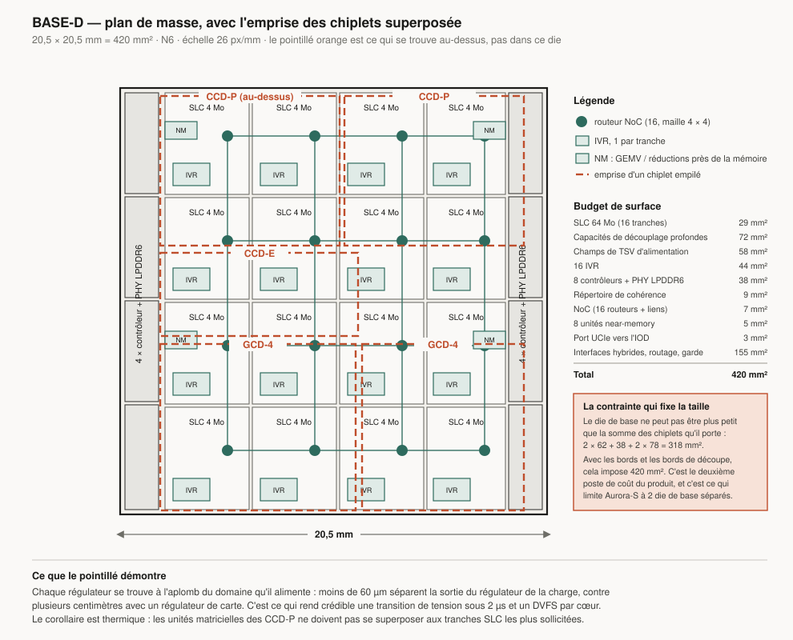
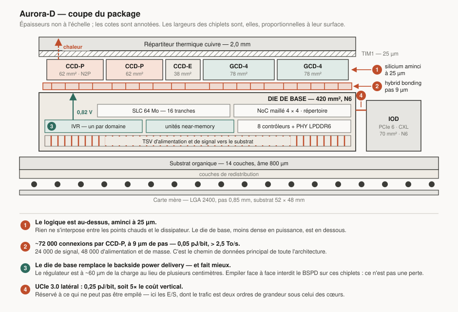
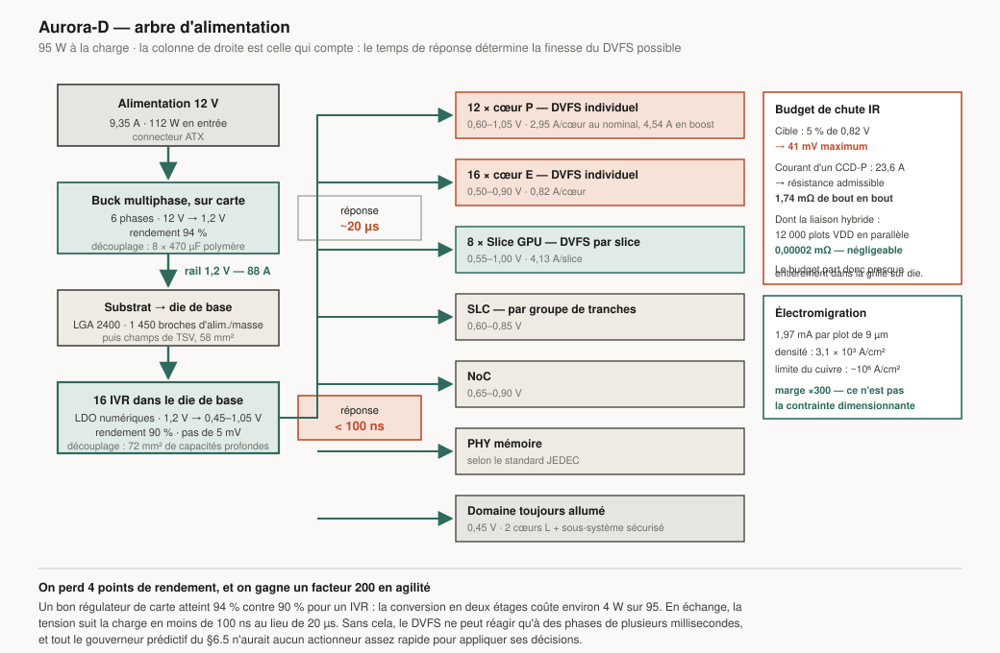
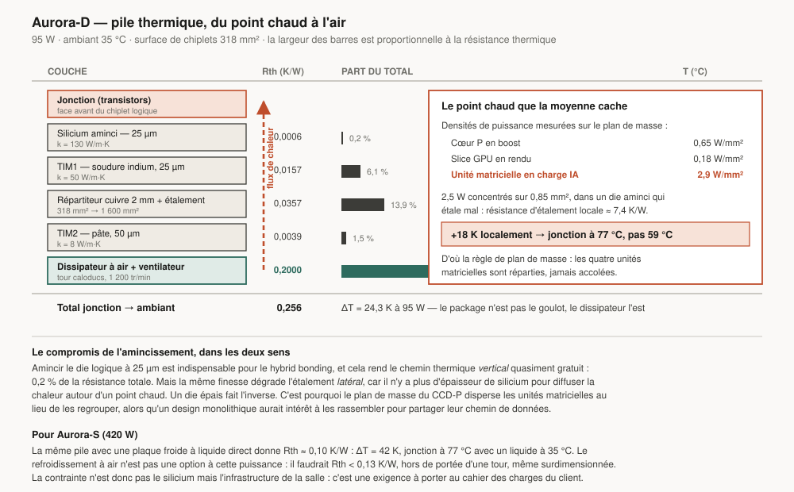

# 12. Plans de construction

> Les documents 1 à 11 disent *quoi* construire et *pourquoi*. Celui-ci dit
> *comment* : cotes, plans de masse, budgets de connexion, réseau
> d'alimentation, thermique, séquence d'assemblage, nomenclature et coût.
>
> Dessiner ces plans a corrigé quatre choses dans le reste du dossier. Elles
> sont listées en [§12.12](#1212-ce-que-le-fait-de-dessiner-a-corrigé) plutôt
> que dissimulées.

---

## 12.1 Nomenclature des dies

| Die | Contenu | Procédé | Cotes | Surface |
|---|---|---|---|---|
| **CCD-P** | 8 cœurs P, 16 Mo L2, 4 unités matricielles, 1 Mo de mémoire de tuile | N2P | 8,60 × 7,20 mm | 61,9 mm² |
| **CCD-E** | 16 cœurs E, 4 Mo L2, 4 unités matricielles | N2P | 9,50 × 4,00 mm | 38,0 mm² |
| **GCD-4** | 4 Slices GPU (16 cœurs, 8 unités RT, 32 unités matricielles) | N2P | 9,40 × 8,30 mm | 78,0 mm² |
| **BASE-M** | SLC 32 Mo, NoC 3 × 3, 4 contrôleurs LPDDR6, 8 IVR | N6 | 11,40 × 11,40 mm | 130 mm² |
| **BASE-D** | SLC 64 Mo, NoC 4 × 4, 8 contrôleurs LPDDR6, 16 IVR, 8 unités near-memory | N6 | 20,50 × 20,50 mm | 420 mm² |
| **BASE-S** | SLC 128 Mo, NoC 6 × 6, 4 contrôleurs HBM4, 24 IVR, 16 unités near-memory | N5 | 21,90 × 21,90 mm | 480 mm² |
| **L4** | 512 Mo de SRAM empilée | N6 | 13,40 × 13,40 mm | 180 mm² |
| **IOD** | PCIe 6, CXL 3.1, USB4v2, réseau, affichage, sous-système sécurisé | N6 | 9,60 × 7,30 mm | 70 mm² |

### Compositions produit

| Produit | Assemblage | Silicium logique | Die(s) de base |
|---|---|---|---|
| Aurora-M | 1 CCD-P trié à 4P + 1 CCD-E trié à 8E + 1 GCD-2 | 89 mm² | 1 × BASE-M |
| Aurora-D | 2 CCD-P + 1 CCD-E + 2 GCD-4 + 1 IOD | 318 mm² | 1 × BASE-D |
| Aurora-S | 2 quadrants, chacun : 4 CCD-P + 1 CCD-E + 2 GCD-4 + 1 L4 + 1 IOD | 884 mm² | **2 × BASE-S** |

**Pourquoi Aurora-S a deux die de base.** Un die de base doit être au moins
aussi grand que la somme des chiplets qu'il porte. Pour Aurora-S, cela ferait
884 mm² plus les bords, soit au-delà de la limite de réticule (~858 mm²). Le
produit est donc construit en **deux quadrants de 480 mm²**, posés sur un
interposeur CoWoS-L et reliés par un pont UCIe-A court. Chaque quadrant porte
32 cœurs P, 16 cœurs E, 8 Slices GPU, 128 Mo de SLC, 512 Mo de L4 et 2 piles
HBM4.

Ce n'est pas un contournement : c'est la contrainte physique qui dicte la
topologie du produit. Elle a une conséquence logicielle — Aurora-S est une
machine **NUMA à deux nœuds**, et l'ordonnanceur doit le savoir (§12.12).

### Les SKU par tri

| SKU | Base | Obtenu par |
|---|---|---|
| Aurora-D 16P | 2 CCD-P complets | dies sans défaut |
| Aurora-D 12P | 2 CCD-P à 6 cœurs actifs | tri : 2 cœurs désactivés par die |
| Aurora-D 8P | 1 CCD-P + 1 emplacement vide | segment d'entrée de gamme |
| Aurora-M 4P/8E | CCD-P et CCD-E triés | récupération des dies partiellement défectueux |

Le SKU modélisé au document 11 est le **12P**, c'est-à-dire la version triée.
C'est volontaire : dimensionner sur la version complète serait optimiste.

---

## 12.2 Plans de masse

### CCD-P

Deux rangées de quatre cœurs encadrent une épine centrale. La règle de
placement qui gouverne tout : **chaque unité matricielle doit être équidistante
des deux cœurs qu'elle sert.** Un déséquilibre se paierait en cycles d'attente
sur le cœur le plus éloigné, et l'unité est partagée précisément pour être
saturée.

Les 41 % de surface qui n'appartiennent à aucun bloc nommé ne sont pas du
gaspillage : ce sont les grilles d'alimentation, le routage global, l'anneau de
garde, les structures de test et l'espacement obligatoire entre macros. Un die
réel n'est jamais un pavage de blocs, et un budget de surface qui l'ignore
sous-estime la puce d'un tiers.

### BASE-D

Seize tuiles identiques, chacune portant une tranche de SLC de 4 Mo, un routeur
de maille et un régulateur intégré. Les contrôleurs mémoire sont sur les bords
gauche et droit, où les signaux peuvent s'échapper vers le substrat.

Le pointillé orange est l'apport de ce plan : il montre **ce qui se trouve
au-dessus**. Chaque régulateur est à l'aplomb du domaine qu'il alimente.

---

## 12.3 La pile 3D

### Ordre d'empilement, et pourquoi

| Position | Élément | Raison |
|---|---|---|
| Haut | Répartiteur cuivre 2 mm | dissipation |
| | TIM1 — soudure indium 25 µm | k = 50 W/m·K, bien meilleur qu'une pâte polymère |
| | **Chiplets logiques, aminci 25 µm** | les points chauds doivent être le plus près possible du dissipateur |
| | Interface hybrid bonding, pas 9 µm | chemin de données principal |
| | **Die de base** | moins dense en puissance, donc tolérable en position basse |
| | TSV + micro-bumps | alimentation et signaux vers le substrat |
| Bas | Substrat 14 couches, LGA | |

### La correction que ce dessin a imposée

Les documents 5, 6 et 9 annonçaient du **backside power delivery sur les
chiplets logiques**. C'est physiquement incompatible avec cet empilement : un
chiplet collé face à face au die de base a sa face avant en bas et sa face
arrière contre le dissipateur. On ne peut pas y faire passer l'alimentation
sans s'interposer dans le chemin thermique.

La bonne réponse n'est pas de renoncer, c'est de constater que **le die de base
rend le BSPD inutile sur ces chiplets, et fait mieux** : le régulateur est à
~60 µm de la charge, contre plusieurs centimètres pour un régulateur de carte,
et le réseau d'alimentation ne dispute aucune couche de routage aux signaux —
ce qui était l'objectif du BSPD.

Le BSPD (Super Power Rail d'A16) reste utilisé là où il a du sens :
**à l'intérieur du die de base**, et sur les variantes non empilées.

---

## 12.4 Budget de l'interface hybrid bonding

Dimensionnement pour un CCD-P :

| Poste | Calcul | Valeur |
|---|---|---|
| Débit à soutenir | 1,5 To/s par CCD-P | 12 Tb/s |
| Fréquence de signalisation | 2 GHz, 1 bit par plot et par cycle | — |
| **Plots de signal** | 12 × 10¹² / 2 × 10⁹ | **6 000** |
| Marge et redondance (×4) | tolérance aux défauts, liens de rechange | 24 000 |
| Courant à fournir | 8 cœurs à 2,95 A | 23,6 A |
| Limite par plot (marge ×300 sur l'EM) | 1,97 mA | — |
| **Plots VDD + VSS** | 2 × 12 000 | **48 000** |
| **Total** | | **~72 000 plots** |
| Surface occupée à 9 µm de pas | 72 000 × 81 µm² | 5,8 mm² |
| Sites disponibles sur la face | 61,9 mm² / 81 µm² | 765 000 |
| **Taux d'occupation** | | **9,4 %** |

Deux enseignements :

1. **Ce n'est pas la densité de connexion qui limite.** À 9 µm de pas, on
   utilise moins d'un dixième des sites disponibles. Le pas pourrait rester à
   9 µm pendant deux générations sans devenir contraignant — ce qui retire le
   hybrid bonding de la liste des risques technologiques du programme.
2. **La contrainte réelle est le rendement de collage**, pas la géométrie
   (§12.9).

---

## 12.5 Réseau d'alimentation

### Budget de chute de tension

| Segment | Résistance admissible | Réalisé |
|---|---|---|
| Carte → socket | 0,30 mΩ | plan de cuivre 2 oz, 1 450 broches |
| Socket → substrat | 0,25 mΩ | LGA + vias traversants |
| Substrat → die de base | 0,20 mΩ | champs de TSV, 58 mm² |
| Régulation (IVR) | — | 16 IVR indépendants |
| Liaison hybride | 0,00002 mΩ | 12 000 plots VDD en parallèle |
| **Grille sur die** | **0,99 mΩ** | **c'est là que part tout le budget** |
| **Total** | **1,74 mΩ à 23,6 A = 41 mV**, soit 5 % de 0,82 V | |

### Découplage, par échelle de temps

| Échelle | Élément | Emplacement |
|---|---|---|
| > 10 µs | 8 × 470 µF polymère | carte, sous le socket |
| 100 ns – 10 µs | 40 × 22 µF MLCC | cavité du socket et substrat |
| 1 – 100 ns | **72 mm² de capacités profondes** | die de base |
| < 1 ns | MIM sur die | dans chaque chiplet |

La couche à 1–100 ns est celle qui manque le plus souvent, et c'est elle qui
détermine si l'horloge adaptative (§6.6) peut réellement supprimer 5 % de marge
de tension. 72 mm² de capacités profondes sur le die de base, c'est 17 % de sa
surface — un investissement délibéré, et le troisième poste de surface du die.

---

## 12.6 Arbre d'horloge

Distribuer 4,2 GHz sur 20,5 mm est impossible : le temps de vol traverserait
plusieurs périodes. L'architecture est donc **hiérarchique** :

| Niveau | Fréquence | Distribution | Écart admissible |
|---|---|---|---|
| Référence globale | 100 MHz | arbre en H sur le die de base | 50 ps |
| Par chiplet | PLL locale | une PLL par paire de cœurs | — |
| Dans un cœur | 4,2 GHz | **maille d'horloge** sur la zone du cœur | **12 ps** (5 % de 238 ps) |
| Dans un bloc | — | arbre en H depuis les points de maille | 6 ps |

**La maille plutôt que l'arbre, dans le cœur.** Une maille consomme plus, mais
son écart est insensible aux variations locales du procédé — et à 238 ps de
période, l'écart est le premier poste qui mange la marge de temps. Hors des
cœurs, où les fréquences sont plus basses, l'arbre suffit.

Budget de puissance d'horloge : **~0,9 W par cœur P à 4,2 GHz**, soit 20 % de
sa puissance, avec une couverture de clock gating supérieure à 92 %. Sans ce
taux de couverture, le chiffre doublerait.

---

## 12.7 Thermique

Le résultat le plus utile n'est pas la moyenne mais le point chaud : **une
unité matricielle sous charge IA atteint 2,9 W/mm², soit 4,5× la densité d'un
cœur P en boost.** Comme le die est aminci à 25 µm, il étale mal la chaleur
latéralement — l'amincissement améliore le chemin vertical et dégrade
l'horizontal.

D'où une règle de plan de masse que le document 2 ne pouvait pas produire :
**les quatre unités matricielles du CCD-P sont réparties le long de l'épine,
jamais accolées.** Un design monolithique aurait eu intérêt à les regrouper
pour partager leur chemin de données ; ici, c'est interdit.

| Produit | Rth cible | Refroidissement | ΔT | Tj à 35 °C |
|---|---|---|---|---|
| Aurora-M, 15 W | 1,80 K/W | caloduc passif + ventilateur | 27 K | 62 °C |
| Aurora-D, 95 W | 0,256 K/W | tour à air | 24 K | 59 °C (77 °C au point chaud) |
| Aurora-S, 420 W | 0,100 K/W | **plaque froide à liquide direct** | 42 K | 77 °C |

Aurora-S exigerait Rth < 0,13 K/W pour tenir à l'air : c'est hors de portée
d'une tour, même surdimensionnée. Le refroidissement liquide n'est donc pas une
option de confort mais **une exigence à porter au cahier des charges du
client**, au même titre que l'alimentation.

---

## 12.8 Package, substrat et mécanique

| Paramètre | Aurora-D | Aurora-S |
|---|---|---|
| Substrat | organique, 14 couches (4+6+4) | CoWoS-L, interposeur silicium + substrat |
| Cotes | 52 × 48 mm | 92 × 82 mm |
| Âme | 800 µm | 1 200 µm |
| Microvias | empilés, 60 µm | 45 µm |
| Interface socket | **LGA 2400**, pas 0,85 mm | LGA 7200, pas 1,0 mm |
| Hauteur totale | 4,6 mm (sans dissipateur) | 6,9 mm |
| Force de maintien | 350 N | 1 200 N, cadre à 8 points |

### Répartition des broches, Aurora-D

| Fonction | Broches |
|---|---|
| Alimentation et masse | 1 450 |
| Mémoire (8 canaux LPDDR6) | 600 |
| PCIe 6.0 ×20 | 80 |
| USB4v2, affichage, réseau | 190 |
| Gestion, test, réserve | 80 |
| **Total** | **2 400** |

La proportion alimentation/masse (60 %) n'est pas négociable : elle découle du
budget de chute de tension du §12.5. Un socket plus petit imposerait une grille
sur die plus épaisse, donc moins de couches pour les signaux.

---

## 12.9 Séquence de fabrication et d'assemblage

### Rendement composé

| Étape | Rendement |
|---|---|
| Collage hybride, par die (5 dies posés) | 99,2 % → 96,1 % |
| Report sur substrat | 99,3 % |
| Underfill et répartiteur | 99,5 % |
| Test final | 99,0 % |
| **Assemblage** | **94,0 %** |

Hypothèse de ligne mûre. **En démarrage de production, compter 85 à 88 %** — et
le budget du document 10 provisionne cette montée en apprentissage.

### Pourquoi le tri des bons dies décide de l'économie du produit

Coller un die défectueux sur un die de base sain détruit les deux. Le die de
base coûte 96 $, le CCD-P 28 $ : une erreur de tri coûte 124 $, soit plus de
trois fois la valeur du die écarté.

**Un point de couverture de test gagné à la porte de tri vaut donc davantage
qu'un point de rendement gagné en lithographie.** C'est contre-intuitif, et
cela oriente le budget DFT : c'est la justification chiffrée de l'objectif de
99 % de couverture du §9.4.

---

## 12.10 Nomenclature et coût unitaire

### Coût du silicium, Aurora-D

Hypothèses : wafer 300 mm (70 686 mm²), N2P à 25 000 $, N6 à 10 000 $, modèle
de rendement de Murphy, D₀ = 0,15/cm² sur N2P et 0,10/cm² sur N6.

| Die | Surface | Dies bruts | Rendement | Dies bons | Coût unitaire | Qté | Total |
|---|---|---|---|---|---|---|---|
| CCD-P | 62 mm² | 1 035 | 91 % | 942 | 27,50 $ | 2 | 55,00 $ |
| CCD-E | 38 mm² | 1 668 | 94 % | 1 568 | 15,90 $ | 1 | 15,90 $ |
| GCD-4 | 78 mm² | 824 | 89 % | 733 | 34,10 $ | 2 | 68,20 $ |
| BASE-D | 420 mm² | 155 | 67 % | 104 | 96,20 $ | 1 | 96,20 $ |
| IOD | 70 mm² | 940 | 93 % | 874 | 11,40 $ | 1 | 11,40 $ |
| | | | | | **Silicium** | | **246,70 $** |

### Coût complet

| Poste | Coût |
|---|---|
| Silicium | 246,70 $ |
| Substrat 14 couches | 22,00 $ |
| Assemblage (collage hybride, 5 dies) | 28,00 $ |
| TIM1 + répartiteur | 6,00 $ |
| Test (sondage, pile, final) | 18,00 $ |
| **Sous-total** | **320,70 $** |
| Perte d'assemblage (÷ 0,94) | +20,50 $ |
| **Coût de fabrication** | **≈ 341 $** |

À 55 % de marge brute, cela place le prix catalogue autour de **760 $** — un
positionnement cohérent avec un SoC desktop haut de gamme à GPU intégré.

### Aurora-S, par socket

| Poste | Coût |
|---|---|
| 8 CCD-P | 220,00 $ |
| 2 CCD-E | 31,80 $ |
| 4 GCD-4 | 136,40 $ |
| 2 BASE-S (N5, 480 mm², rendement 58 %) | 468,00 $ |
| 2 L4 | 66,00 $ |
| 2 IOD | 22,80 $ |
| **4 piles HBM4** | **≈ 1 600,00 $** |
| Interposeur CoWoS-L et assemblage | 350,00 $ |
| Test | 60,00 $ |
| Perte d'assemblage (÷ 0,90) | +328,00 $ |
| **Coût de fabrication** | **≈ 3 283 $** |

**La HBM4 représente à elle seule 49 % du coût.** C'est le fait économique
dominant d'Aurora-S, et il a deux conséquences :

1. L'estimation est la plus incertaine du dossier — le prix de la HBM dépend
   d'un marché tendu que nous ne contrôlons pas.
2. Toute réduction du besoin en bande passante externe — L4, near-memory,
   compression — se traduit directement en coût de nomenclature, pas seulement
   en watts. Les mécanismes du document 4 se justifient donc **deux fois**.

---

## 12.11 Règles d'intégration carte

Pour l'intégrateur qui conçoit la carte mère :

| Règle | Valeur | Raison |
|---|---|---|
| Modules LPCAMM3 | à moins de 30 mm du bord du package | intégrité du signal à 14,4 GT/s |
| Couches de la carte | 8 minimum (12 recommandé) | plans d'alimentation continus |
| VRM | à moins de 25 mm | inductance de boucle |
| Découplage en cavité | 40 × 22 µF MLCC, 0402 | échelle 100 ns |
| Impédance différentielle | 85 Ω ±7 % (PCIe, UCIe externe) | |
| Zone d'exclusion thermique | 5 mm autour du package | flux d'air |
| Capteurs de température | 2 sur la carte, lus par le gouverneur | §6.5 |
| Séquencement d'alimentation | 12 V → 1,2 V → rails IVR, 3 étages | protection des grilles |

---

## 12.12 Ce que le fait de dessiner a corrigé

Quatre erreurs, toutes trouvées en passant du texte au plan coté.

**1. Le die de base était trois fois trop petit.** Les documents annonçaient
150 mm² pour BASE-D, alors qu'il doit porter 318 mm² de chiplets. Un support ne
peut pas être plus petit que ce qu'il supporte. Corrigé à 420 mm² — ce qui en
fait le deuxième poste de coût du produit, et change la conclusion économique
du chapitre chiplets.

**2. Aurora-S dépassait la limite de réticule.** Avec 884 mm² de chiplets, un
die de base unique était impossible. Le produit devient une machine à **deux
quadrants**, donc **NUMA à deux nœuds** — une conséquence logicielle qui remonte
jusqu'à l'ordonnanceur du document 8, et qu'aucun paragraphe de prose n'avait
fait apparaître.

**3. Le backside power delivery était incompatible avec l'empilement.** Voir
§12.3. La correction améliore l'architecture au lieu de l'affaiblir, mais elle
n'aurait jamais été trouvée sans dessiner la coupe.

**4. Aurora-D annonçait 12 cœurs P avec un seul CCD-P de 8 cœurs.** Le produit
porte deux CCD-P ; le SKU à 12 cœurs est la version triée.

Une cinquième correction est venue de la thermique plus que du dessin :
**l'amincissement du die dégrade l'étalement latéral de la chaleur**, ce qui
impose de disperser les unités matricielles au lieu de les regrouper (§12.7).

C'est l'argument pour faire ce travail tôt. Un plan coté est un test : il
échoue bruyamment quand deux décisions prises dans deux chapitres différents ne
tiennent pas ensemble. La prose, elle, accepte n'importe quoi.

---

**Retour au [sommaire](README.md).**
